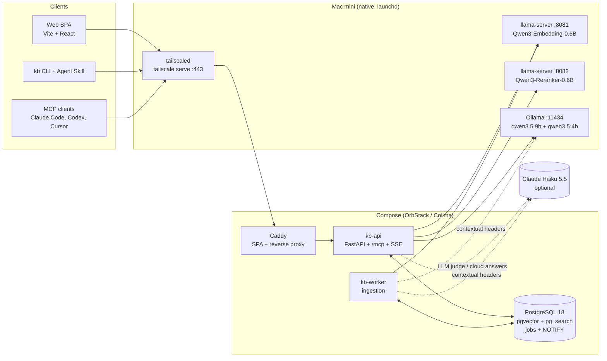
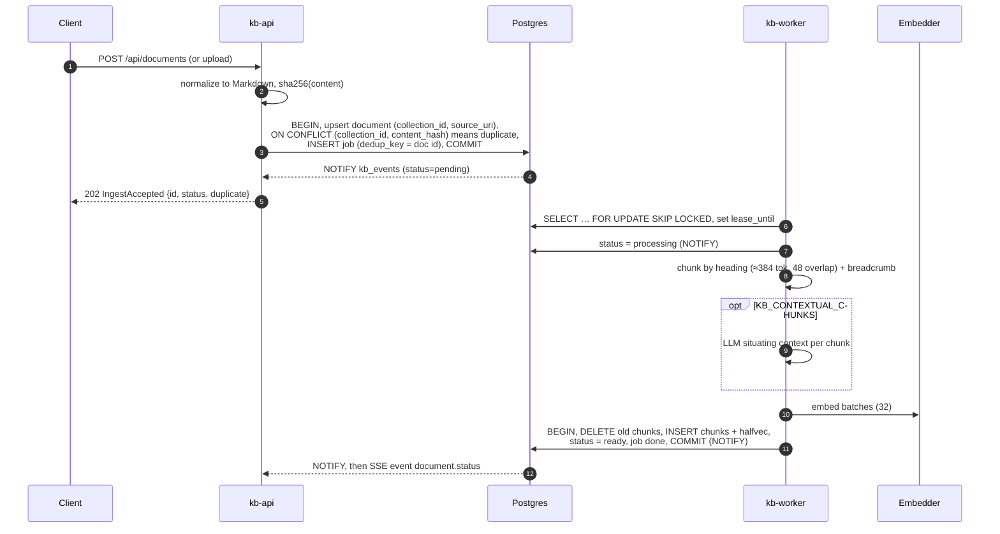
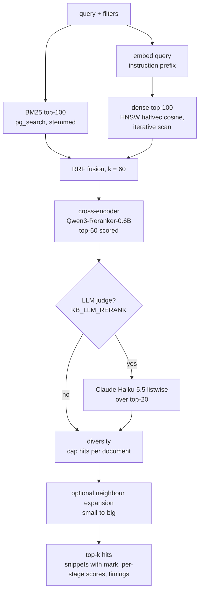
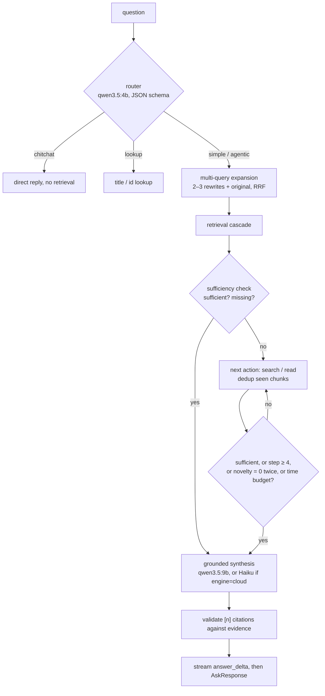

# Architecture

The kb is a self-hosted knowledge base for one Apple Silicon Mac mini. It has hybrid search, agentic Q&A with citations, and three access paths: web UI, CLI + Agent Skill, and MCP. This document describes the system as built. The reasoning behind each choice is in the [ADRs](adr/README.md), and the evidence is in the [research synthesis](research/README.md). The HTTP contract is in [api.md](api.md).

## 1. Components

| Process | Entry point | Responsibility |
|---|---|---|
| `kb-api` | `kb.api.server:main` | REST (`/api/*`), MCP (`/mcp`), SSE (`/api/events`, `/api/ask/stream`), static SPA |
| `kb-worker` | `kb.ingest.worker:main` | Leases jobs, then parses, chunks, (optionally) contextualizes and embeds, and writes chunks |
| `kb` | `kb.cli.main:app` | Thin HTTP client for humans and coding agents |
| Postgres | ParadeDB image, PG 18 | Metadata, chunks, vectors, BM25, job queue, query log, event fan-out |
| Model servers | native | Embeddings, rerank and chat behind OpenAI-compatible HTTP |

All business logic lives in the shared core (`kb.ingest.service`, `kb.search.pipeline` and `kb.agent.loop`). REST, MCP and the CLI are thin adapters over it and share the Pydantic models in `kb/schemas.py`.

## 2. Ingestion flow

- **No transaction is held across model calls.** Parsing and embedding happen outside a transaction. The final write replaces all of a document's chunks atomically, so a document is never half-indexed.
- **Idempotency.**
  - `unique (collection_id, content_hash)` turns re-submitting identical content into a no-op that returns the existing id (`duplicate: true`).
  - `unique (collection_id, source_uri)` makes re-ingesting a changed file at the same URI an update of the same row, not a new document.
  - The partial unique `jobs_dedup_idx` lets at most one queued or running job exist per document.
- **Failure.** A failed job is retried with backoff until `max_attempts` (5). After that the document becomes `failed` and `error` is set, and `POST /reindex` re-enqueues it.

## 3. Query flow: the retrieval cascade

| Stage | Candidates | Config | Degraded behaviour |
|---|---|---|---|
| BM25 | 100 | `KB_SEARCH_CANDIDATES` | none (database only) |
| Dense | 100 | same | embedder down: skipped, `degraded: ["dense"]` |
| RRF | union, ≤ 200 | `KB_RRF_K=60` | — |
| Cross-encoder | 50 | `KB_RERANK_CANDIDATES` | reranker down: RRF order kept, `degraded: ["rerank"]` |
| LLM judge | 20 | `KB_LLM_RERANK`, `KB_LLM_RERANK_TOP_N` | off by default; on failure the cross-encoder order is kept |
| Output | `limit` (default 10, max 100) | `KB_DEFAULT_LIMIT` | — |

`mode=lexical` and `mode=semantic` run a single retriever. Every response carries `timings[]` per stage and `degraded[]`, and each query is written to `query_log` for analytics and offline evaluation.

## 4. Agentic answer loop

- Every model call uses non-thinking mode and schema-constrained JSON. A malformed reply gets one repair retry, then the step falls back to a deterministic `search(question)`.
- Retrieved text is treated as untrusted data. It is wrapped in delimiters and never placed in system prompts.
- If the evidence is still insufficient, the answer says so ("not found in the knowledge base") and lists the best sources.
- `POST /api/ask/stream` emits `event: step` (`plan`, `search`, `read`, `reflect`, `answer_delta`) and then `event: done` with the full `AskResponse`.

## 5. Process topology on the Mac mini

| Runs where | Service | Bind | Supervisor | Why there |
|---|---|---|---|---|
| Native | `llama-server` embed (Q8_0 GGUF, `--embedding --pooling last`) | 127.0.0.1:8081 | launchd LaunchDaemon, `KeepAlive` | needs Metal |
| Native | `llama-server` rerank (ggml-org Q8_0, `--reranking --pooling rank`) | 127.0.0.1:8082 | launchd | needs Metal; Ollama has no rerank endpoint |
| Native | Ollama (`OLLAMA_KEEP_ALIVE=-1`, `OLLAMA_CONTEXT_LENGTH=16384`, `OLLAMA_NUM_PARALLEL=2`) | 127.0.0.1:11434 | launchd (`brew services`) | Metal/MLX, schema-constrained JSON |
| Native | `tailscaled` + `tailscale serve` | tailnet :443 | launchd | remote access, no open ports |
| Native | backup (`pg_dump -Fc` + restic) | — | launchd `StartCalendarInterval` | runs missed jobs after wake |
| Compose | Postgres 18 (ParadeDB image), named volume | 127.0.0.1:5432 | `restart: unless-stopped` + `pg_isready` | no extension builds on macOS |
| Compose | `kb-api` (uvicorn, `KB_WORKERS=2`) | :8787 inside the network | restart + `/api/health` | reproducible |
| Compose | `kb-worker` (concurrency 4) | — | restart | isolates ingestion CPU and memory spikes from queries |
| Compose | Caddy | 127.0.0.1:8080 | restart | single front door: SPA + `/api`, `/mcp` |

Containers reach the native model servers through `host.docker.internal`. Memory budget on 32 GB:

| Item | Memory |
|---|---|
| Embed + rerank servers | ≈ 3 GB |
| `qwen3.5:9b` + `qwen3.5:4b` in Ollama | ≈ 10 GB |
| Postgres VM | 6–8 GB |
| macOS | ≈ 4 GB |
| API and worker | small |

## 6. Concurrency and availability

- **MVCC.** Readers never block writers. Search runs against a consistent snapshot while many workers insert chunks. Each document's chunk replacement is a single short transaction.
- **Connection pools.** Each process opens one psycopg async pool (`KB_DB_POOL_MIN=2`, `KB_DB_POOL_MAX=16`), with a per-connection `statement_timeout` of 15 s. Each API process also holds **one dedicated LISTEN connection** outside the pool.
  - The worst case for connections is (2 API + 1 worker) × 16 + LISTEN connections, which stays well under Postgres's default `max_connections=100`.
- **Job leases.**
  - Workers claim jobs with `SELECT … FOR UPDATE SKIP LOCKED` ordered by `(priority desc, run_after, id)`, then set `status='running'`, `locked_by` and `lease_until = now() + 300 s`.
  - A crashed worker's job becomes claimable again once its lease expires (`jobs_lease_idx`).
  - Retries use `run_after` for exponential backoff.
  - Work is idempotent, so redelivering a job is safe.
- **Advisory locks.** `pg_advisory_lock` serialises schema migrations, so many processes can start at once. The same mechanism is available for any singleton maintenance task.
- **Circuit breakers.** Each model provider has a three-state breaker: it opens after 3 consecutive failures and goes half-open after 30 s. Calls are bounded by `KB_MODEL_TIMEOUT_S=30`. A dead model server costs one timeout, not one per request. The resulting degraded modes:

  | Down | Effect |
  |---|---|
  | Embedder | BM25-only search. Ingestion jobs back off and retry. |
  | Reranker | RRF order kept. |
  | Local LLM | `/ask` fails fast with a clear error. Search is unaffected. |
  | Claude | Optional stages are skipped. |

  `/api/health` reports `ok`, `degraded` or `down` for each component.
- **Events.** A trigger on `documents` calls `pg_notify('kb_events', …)` when a document is created or its status changes. Every API process LISTENs, fans out into bounded per-client queues (a slow client drops events and never stalls the database), and streams them over SSE with a 15 s ping. Because NOTIFY is transactional, clients never see a status that later rolls back.
- **Restart safety.** Every compose service uses `restart: unless-stopped` with health checks, and launchd uses `KeepAlive`. pmset `autorestart 1` restarts the machine after a power loss. Durable state lives only in Postgres.

## 7. Data model

| Table | Key columns | Notes |
|---|---|---|
| `collections` | `id uuidv7`, `slug` unique | Top-level scope; `default` is seeded |
| `documents` | `collection_id`, `title`, `source_uri`, `content_hash`, `body`, `tags text[]`, `metadata jsonb`, `status`, `chunk_count` | Unique on `(collection_id, content_hash)`; partial unique on `(collection_id, source_uri)`; GIN on tags |
| `chunks` | `document_id`, `collection_id` (denormalised), `ord`, `heading_path`, `content`, `context`, `embedding halfvec(1024)` | HNSW (`m=16, ef_construction=128`); BM25 index over `id, content, context, heading_path, collection_id, document_id` |
| `jobs` | `kind`, `payload`, `status`, `priority`, `attempts`, `run_after`, `locked_by`, `lease_until`, `dedup_key` | `SKIP LOCKED` queue ([ADR 0008](adr/0008-postgres-skip-locked-job-queue.md)) |
| `query_log` | `query`, `mode`, `filters`, `latency_ms`, `result_ids` | Recent searches, analytics, eval |
| `schema_migrations` | `name`, `checksum` | Applied under an advisory lock |

Primary keys use PG 18 `uuidv7()`, which is time-ordered and gives good B-tree locality. Chunk ids are `bigint identity`, which keeps the BM25 key compact. The embedding dimension is substituted at migration time from `KB_EMBEDDING_DIM`. Changing the embedding model means re-embedding the corpus.

## 8. Security model

- **Network.** Every listener binds to `127.0.0.1`. Remote access is only through **Tailscale Serve** (WireGuard, tailnet ACLs, automatic HTTPS) in front of Caddy. Funnel is not used.
- **Authentication.** A single bearer token (`KB_API_TOKEN`) is required on write endpoints and on `/mcp`. It is compared in constant time. Reads are open only because the service is reachable only from localhost or the tailnet. Set the token whenever the tailnet is shared.
- **Clients.** The CLI reads `KB_URL` / `KB_TOKEN` from the environment. MCP clients send `Authorization: Bearer …` (for example `claude mcp add --transport http kb … --header`).
- **Model I/O.** Retrieved content is untrusted. The agent's tools are read-only and validate their arguments. The agent cannot fetch URLs or touch the filesystem.
- **Cloud.** Calls to Claude are opt-in: `KB_ANTHROPIC_API_KEY`, `KB_LLM_RERANK`, `KB_CONTEXTUAL_CHUNKS`, or `engine=cloud`. Rerank sends only snippets.
- **Data at rest.** Data sits in the Postgres volume. Backups go through `pg_dump` + restic, which encrypts them. If FileVault is off for unattended reboot, encrypted backups are the compensating control.
- **Licensing.** pg_search is AGPL-3.0. We run it unmodified for a self-hosted personal deployment ([ADR 0001](adr/0001-single-postgres.md)).
